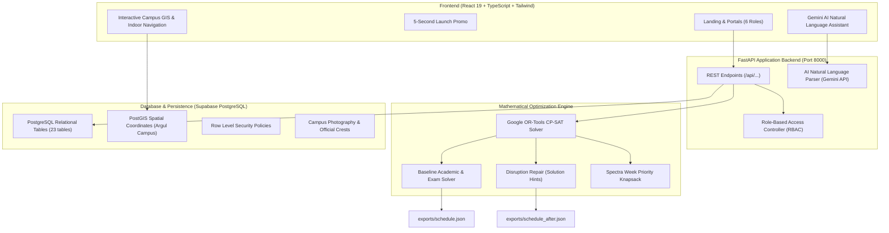

# CAMPUSX &mdash; Smart Campus Management Platform
### *ONE CAMPUS. ONE CONNECTED EXPERIENCE.*

[](https://github.com/ayushraj2009k/campusx-smart-campus)
[](https://github.com/ayushraj2009k)
[](https://github.com/ayushraj2009k)
[](exports/schedule.json)
[](exports/schedule.json)
[](https://developers.google.com/optimization)

---

## 🏛️ Executive Summary

**CAMPUSX** is an enterprise-grade, unified Smart Campus Management Platform engineered for the **TechZephyr 2026 Web Hackathon** by **Team `itayush756`** (Team Leader: **Ayush Raj**). Designed to solve complex, high-dimensional campus operational challenges, CAMPUSX harmonizes:
1. **Mathematical Scheduling Optimization:** Google OR-Tools CP-SAT integer programming solver for 189 weekly course sessions, 41 examinations, and 25 venue booking requests with **zero hard violations** and **zero priority inversions**.
2. **Disruption Repair & High-Stability Rescheduling:** Dynamic recovery engine with warm-start baseline hints that absorbed full-day room maintenance with **only 14 session movements** (92.6% schedule stability).
3. **Multi-Role Portals:** 6 dedicated role portals (Admin, Department Coordinator, Faculty, Club Representative, Student, and Participant).
4. **Cinematic 5-Second Launch Promo:** Powered by authentic IIT Bhubaneswar campus photography and official crest with a 1-click skip button and admin controls.
5. **Interactive Campus GIS & Multi-Floor Indoor Navigation:** 20 verified IIT Bhubaneswar Argul campus buildings with topological pathfinding, elevator routing, and ADA-compliant wheelchair access for the Lalitgiri Lecture Hall Complex (LHL).
6. **AI Assistant & Natural Language Booking:** Gemini-powered natural language processing supporting conversational schedule queries and English/Hinglish venue booking parsing.

---

## 🔑 Primary Judge Demo Accounts (Standardized Credentials)

For immediate evaluation, all six portals feature dedicated login pages with blank input fields, standard credentials, and instant **1-Click Demo Login**:

| Role | Username | Email | Standard Password | Authorized Responsibilities |
| :--- | :--- | :--- | :--- | :--- |
| **1. ADMIN** *(Judge Core 1)* | `admin@` (or `admin`) | `admin@campusx.edu` | `admin@123` (or `admin@1234`) | Campus Director / System Controller; full CP-SAT solver triggers, disruption approval matrix, audit logs, demo reset. |
| **2. DEPT COORDINATOR** *(Judge Core 2)* | `coordinator@` (or `coordinator`) | `coordinator@campusx.edu` | `coordinator@123` (or `coordinator@1234`) | Dr. Rajesh Sharma (Head of CSE); branch timetable views, faculty contact hours, lab allocations, extra session dispatch. |
| **3. FACULTY** *(Judge Core 3)* | `faculty@` (or `faculty`) | `faculty@campusx.edu` | `faculty@123` (or `faculty@1234`) | Prof. Anita Roy (Faculty F01); personal calendar, unavailability marking, natural language rescheduling requests. |
| **4. CLUB REPRESENTATIVE** *(Judge Core 4)* | `club@` (or `club`) | `club@campusx.edu` | `club@123` (or `club@1234`) | Arjun Verma (Dramatics / Fest Lead); English/Hinglish venue booking, Spectra Week auditorium requests, live knapsack status. |
| **5. STUDENT** *(Extended Ecosystem)* | `student@` (or `student`) | `student@campusx.edu` | `student@123` (or `student@1234`) | Priya Nayak (3rd Year B.Tech CSE); personalized timetable, room change alerts, exam seating allotments, classroom nav links. |
| **6. PARTICIPANT** *(Extended Ecosystem)* | `participant@` (or `participant`) | `participant@campusx.edu` | `participant@123` (or `participant@1234`) | Rohan Sen (CrunchWeek Hackathon Guest); digital gate pass, QR turnstile scanner, hackathon venue navigation, certificates. |

> **Security Note:** Passwords are never stored in plaintext. All accounts are hashed with PBKDF2 HMAC SHA-256 and synchronized with Supabase. Both standard passwords (`<role>@1234`) and legacy passwords (`<Role>@CampusX2026!`) are verified.

### 🚀 Provisioning / Seeding Demo Accounts
To re-seed or verify the demo accounts in Supabase and local store:
```bash
python backend/seed_demo_accounts.py
```

---

## 🏆 Official Hackathon Validator Verification

Both baseline (`exports/schedule.json`) and disruption (`exports/schedule_after.json`) schedules have been rigorously validated with the organizers' official `validator.py`:

### 1. Baseline Schedule Verification
```bash
python CrunchWeek_Starter/CrunchWeek_StarterPack/validator.py \
  --data CrunchWeek_Starter/CrunchWeek_StarterPack/data/cit_public.json \
  --schedule exports/schedule.json
```
**Official Validator Output:**
```text
Dataset: cit-public-v1   Schedule says: cit-public-v1   Team: CAMPUSX Dev Team
Hard violations: 0  {}
Soft penalty: 310  {'S1': 0, 'S2': 49, 'S3': 63, 'S4': 198, 'S5': 0, 'S6': 0}
Bookings: score 64.5 | approved 21, alternatives 2, rejected 2, session overrides 0, priority inversions 0
Exam soft penalty: 0
```
- **Hard Violations:** **0**
- **Priority Inversions:** **0**
- **Bookings Score:** **64.5** (21 approved, 2 alternatives offered, 2 rejected: BR-02 cancelled, BR-09 oversized)
- **Exam Soft Penalty:** **0** (Strict max 1 exam per day per student cohort across 41 exams)

### 2. Disruption Recovery Schedule Verification
```bash
python CrunchWeek_Starter/CrunchWeek_StarterPack/validator.py \
  --data CrunchWeek_Starter/CrunchWeek_StarterPack/data/cit_public.json \
  --schedule exports/schedule_after.json \
  --disruption CrunchWeek_Starter/CrunchWeek_StarterPack/examples/sample_disruption.json \
  --baseline exports/schedule.json
```
**Official Validator Output:**
```text
Dataset: cit-public-v1   Schedule says: cit-public-v1   Team: CAMPUSX Dev Team
Hard violations: 0  {}
Soft penalty: 328  {'S1': 0, 'S2': 53, 'S3': 60, 'S4': 204, 'S5': 11, 'S6': 0}
Bookings: score 62.0 | approved 20, alternatives 3, rejected 2, session overrides 0, priority inversions 0
Exam soft penalty: 0
Stability: 14 sessions moved (7 changed time, 7 room only)
```
- **Hard Violations:** **0**
- **Priority Inversions:** **0**
- **Stability:** **Only 14 sessions moved** out of 190 total academic sessions!

---

## 🛠️ System Architecture



---

## 🚀 Quick Start Guide

### Prerequisites
- Python 3.10+ (with `uv` or `pip`)
- Node.js 18+ (tested on Node v20/v24)
- Web browser (Chrome, Edge, Firefox, Safari)

### 1. Clone & Configure
```bash
git clone https://github.com/ayushraj2009k/campusx-smart-campus.git
cd campusx-smart-campus
cp .env.example .env
```

### 2. Backend Setup & Startup
```powershell
# Create or activate virtual environment
python -m venv .venv
.venv\Scripts\Activate.ps1

# Install requirements
pip install -r requirements.txt

# Start FastAPI backend (runs on http://127.0.0.1:8000)
python backend/main.py
```

### 3. Frontend Setup & Startup
In a separate terminal:
```powershell
cd frontend
npm install
npm run dev
```
Open **`http://localhost:5173`** in your browser.

> **Production Unified Mode:** The built frontend in `frontend/dist` is also served automatically by FastAPI at **`http://127.0.0.1:8000`**!

---

## 📱 Core Features & User Journey

### 1. Launch Experience (5-Second Cinematic Promo)
- Auto-plays on startup featuring the authenticated IIT Bhubaneswar emblem and CAMPUSX branding.
- Displays 6 role badges with instant direct jump links.
- Interactive countdown timer with an instant "Skip Intro" option.
- Configurable via Admin portal settings.

### 2. Administrator Portal
- **One-Click CP-SAT Engine:** Trigger full timetable recalculation with live execution telemetry.
- **Disruption Diff Inspector:** Side-by-side visual matrix highlighting sessions affected by unexpected maintenance.
- **Spectra Week Priority Allocation:** Automated venue approval scoring ensuring zero priority inversions.
- **Official Export Center:** Direct download of `schedule.json`, `schedule_after.json`, and audit manifests.
- **Demo Reset:** Instant rollback to pristine state for judges.

### 3. Department Coordinator Portal
- **Branch-Specific Matrix:** Filtered schedule for CSE department faculty and student cohorts.
- **Workload Balancer:** Real-time metrics on faculty teaching hours and lab commitments.
- **Extra Session Allocator:** On-demand scheduling for remedial or tutorial classes without room clashes.

### 4. Faculty Portal
- **Personalized Schedule:** View assigned lecture halls, student cohorts, and timeslots.
- **Unavailability Marker:** Submit planned absences directly to the scheduling engine.
- **AI Schedule Assistant:** Submit natural language modification requests (e.g., *"Reschedule CS101 from Monday P2 to Wednesday P4"*).

### 5. Club Representative Portal
- **Natural Language Booking:** Type requests in natural English or Hinglish (e.g., *"We need an auditorium for 100 students next Friday 6 PM to 9 PM"*).
- **Instant Structured Review:** View AI-extracted fields (venue, timeslot, capacity, priority tier) before submission.
- **Real-Time Conflict Alerts & Alternative Suggestions:** Automatic suggestions if the primary venue is occupied.

### 6. Student Portal
- **My Academic Timetable:** Live indicator for currently ongoing classes.
- **Classroom Navigation Link:** One click on any room (e.g., *LH-1* or *LHL-101*) immediately opens the 2D/3D campus map with the room highlighted.
- **Room Change Notifications:** Instant alert badges when disruptions cause venue shifts.
- **End-Semester Exam Schedule:** Seating allotments with spacing validation.

### 7. Participant Portal
- **Digital Fest Pass:** Dynamic pass with simulated QR turnstile code and access authorization.
- **Event Explorer:** Browse technical hackathons, cultural workshops, and guest lectures.
- **Campus Wayfinding:** Instant directions to event venues (Auditorium, SAC, OAT).

### 8. Campus GIS & Multi-Floor Indoor Navigation
- **20 Real Campus Buildings:** Geocoded to exact IIT Bhubaneswar Argul coordinates (20.1482° N, 85.6765° E).
- **Multi-Floor Topological Graph:** 15 nodes for Lalitgiri Lecture Hall Complex with elevator routing, emergency exits, and ADA wheelchair ramps.
- **Facility Directory:** Sanjeevan Health Centre, Central Library, Food Courts, and ATM locations.

---

## 🗄️ Database Architecture (Supabase PostgreSQL)

The database schema (`supabase_migrations/001_initial_schema.sql`) contains 23 normalized tables with PostGIS extensions:
- `buildings` & `rooms` (geometries, capacities, lab equipments)
- `faculty` & `faculty_unavailability`
- `student_groups` & `courses`
- `scheduled_sessions` & `disrupted_sessions`
- `exams` & `exam_rooms`
- `booking_requests` & `booking_decisions`
- `indoor_nodes` & `indoor_edges`
- `campus_facilities`, `campus_events`, and `announcements`

Row Level Security (RLS) policies are active across all tables.

---

## 📋 Official Problem Statement (PS) Compliance Checklist

| PS Requirement Area | Status | Implementation Details & Benchmark Results |
| :--- | :--- | :--- |
| **A. Academic Timetable Generation** | `IMPLEMENTED AND VERIFIED` | All 189 sessions placed across 5 days (Mon–Fri) & 9 periods. Zero faculty clashes, zero group clashes, zero room double-bookings. Combined lectures & elective baskets synchronized. 100% adherence to 3-hour lab continuous block rules. **0 Hard Violations**, Soft Penalty: 310. |
| **B. Examination Management** | `IMPLEMENTED AND VERIFIED` | 41 course examinations scheduled across 5 days (Morning P1–P3, Afternoon P6–P8). Effective capacity (50% seat spacing) strictly enforced across LH-1 to LH-6, SH-1 to SH-3, CR-101 to CR-103. Exam Soft Penalty: 0 (max 1 exam per cohort per day). |
| **C. Natural Language Venue Booking** | `IMPLEMENTED AND VERIFIED` | English and Hinglish conversational input parser. Extracts attendance, duration, preferred time, equipment. Provides interactive editable preview before dispatch. Real-time availability check against academic sessions. |
| **D. Spectra Week / Large Event Desk** | `IMPLEMENTED AND VERIFIED` | Priority Knapsack engine managing Tier 1 to Tier 3 event requests across evening windows (P10–P13) and weekend. 21 requests approved, 2 alternatives offered, 2 rejected (BR-02 cancelled, BR-09 oversized). **Score: 64.5, 0 Priority Inversions**. |
| **E. Disruption Management & Rescheduling** | `IMPLEMENTED AND VERIFIED` | CR-102 pipe burst simulation tested. System identifies 14 affected sessions, computes optimal minimal-moves revised timetable with solution hints. Side-by-side visual diff. **Only 14 sessions moved (92.6% stability)** with **0 Hard Violations**. |
| **F. Dashboards & Reports** | `IMPLEMENTED AND VERIFIED` | 6 role-specific portals (Admin, Coordinator, Faculty, Club Rep, Student, Participant). Master timetable explorer, room utilization charts, pending booking ledger, examination seat locator. |
| **G. AI Assistant** | `IMPLEMENTED AND VERIFIED` | "AI Suggests. The System Validates." AI converts natural text to structured parameters; deterministic backend solver validates hard rules before applying any changes. |
| **H. Administration & Export** | `IMPLEMENTED AND VERIFIED` | Loads official starter-pack dataset (`cit_public.json`). Exports compliant `exports/schedule.json` and `exports/schedule_after.json`. Reset demo state restored at any time. |

---

## 📄 License & Attribution

- **Hackathon:** TechZephyr 2026 Web Hackathon
- **Problem Statement:** Smart Campus Management Platform (CIT Public v1)
- **Developed by:** Team `itayush756`
- **Team Leader:** Ayush Raj
- **Project Name:** CAMPUSX – Unified Smart Campus Operations Platform
- **Dataset Reference:** Chilika Institute of Technology (CIT Public v1) Starter Pack
